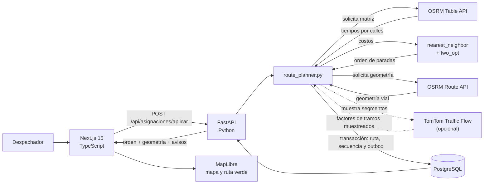

# Arquitectura de Rutas Pasto

Abre el [esquema 3D interactivo](./arquitectura-3d.html) para recorrer las
conexiones y abrir desde cada componente los archivos correspondientes en VS Code.

Vista para presentación técnica y operación: el producto permite registrar pedidos,
optimizar rutas de calle dentro de Pasto, seguir una entrega por guía y enviar avisos
solo por canales autorizados.

## Flujo de optimización

OSRM calcula los tiempos y la geometría por calles. TomTom solo puede ajustar los
tramos que el backend muestrea sobre esa geometría; no sustituye el trazado vial ni
representa cobertura completa de la ciudad. Si esos factores cambian el orden, el
backend vuelve a pedir la geometría vial antes de persistir la ruta.

## Estructuras de datos en el producto

| Estructura                             | Uso concreto                                                                                                               | Implementación                                                                                                                                                                                                            |
| -------------------------------------- | -------------------------------------------------------------------------------------------------------------------------- | ------------------------------------------------------------------------------------------------------------------------------------------------------------------------------------------------------------------------- |
| Lista simplemente enlazada + cola FIFO | Serializa escrituras de ubicación GPS y aplica backpressure.                                                               | [`queue.py`](../../backend/app/core/structures/queue.py), [`location_event_queue.py`](../../backend/app/services/location_event_queue.py)                                                                                       |
| Lista simplemente enlazada + pila LIFO | Deshace el último recálculo usando snapshots persistidos de la ruta.                                                       | [`stack.py`](../../backend/app/core/structures/stack.py), [`route_planner.py`](../../backend/app/services/route_planner.py)                                                                                                     |
